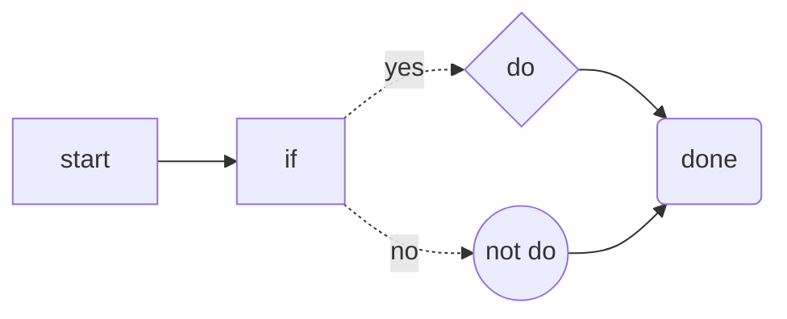

#  deepseek ai 形象的 typora 主题

## 简介

最近，deepseek 的 ai 形象爆火，我觉得很可爱，于是制作了一个以deepseek ai 形象为主的 typora 主题。源代码支持开源协议`MIT`，背景图片都是从网上下载的，感谢广大喜欢deepseek的活跃网友，没有说一声就拿图了，抱歉！感谢LXGUWenKai（霞鹜文楷）的字体开源。

## 如何安装

1. 下载源文件
2. 将文件`deepseek_ai_yan_v1.css`放在文件夹`C:\Users\用户名\AppData\Roaming\Typora\themes`下
3. 将文件夹`deepseek_theme_ai_yan`放在文件夹`C:\Users\用户名\AppData\Roaming\Typora\themes`下,并且解压
4.  重启软件

## 如何更换背景图

打开文件`deepseek_ai_yan_v1`（这是version1，后缀可能会改变），在大约*139-185*行可以找到注释`/* 为页面设置水印背景图片 */`取消掉注释就可以使用文件夹`deepseek_theme_ai_yan`下面的图片，`background-size: 30%;`可以调整图片的大小，   `background-position: 83% bottom;`第一个参数调整图片的水平位置，第二个参数调整图片的垂直位置  ==注意：==只能使用一张图片，不然会冲突。展示代码如下：

```css
#write {
    position: static;
    max-width: 1100px;                    /*编辑区域最大宽度，控制阅读行宽，避免文字过宽*/
    margin: 0 auto;                       /*水平居中*/
    padding: 20px 30px 100px;             /*内边距，上下左右留白*/
    transform: none;

    /* 为页面设置水印背景图片 */

    /* 使用图片1 */
    /*
    background-image: url("./deepseek_theme_ai_yan/deepseek_ai_image_v1_30.png");
    background-repeat: no-repeat;
    background-size: 15%;                  
    background-position: 85% 99%;          
    background-attachment: fixed;
    */

    /* 使用图片2 */
    /*
    background-image: url("./deepseek_theme_ai_yan/deepseek_ai_image_v2_30.png");
    background-repeat: no-repeat;
    background-size: 30%;                  
    background-position: 83% bottom;          
    background-attachment: fixed;
    */

    /* 使用图片3 */
    /*
    background-image: url("./deepseek_theme_ai_yan/deepseek_ai_image_v3_30.png");
    background-repeat: no-repeat;
    background-size: 45%;                  
    background-position: 65% bottom;          
    background-attachment: fixed;         
    */

    /* 使用图片4 */
    
    background-image: url("./deepseek_theme_ai_yan/deepseek_ai_image_v4_30.png");
    background-repeat: no-repeat;
    background-size: 45%;                  
    background-position: 85% 98%;          
    background-attachment: fixed;         
    

    /* 使用图片5 */
    /*
    background-image: url("./deepseek_theme_ai_yan/deepseek_ai_image_v5_30.png"); 
    background-repeat: no-repeat;
    background-size: 45%;                 
    background-position: 88% 98%;          
    background-attachment: fixed;           
    */
}

```


## 如何调整字体大小

打开文件`deepseek_ai_yan_v1`（这是version1，后缀可能会改变），在大约*110-113*行可以找到注释`/*根字号，rem单位以此为基准*/`，改变`font-size`的参数可以调整字体大小。

## 如何调整编辑区宽度

打开文件`deepseek_ai_yan_v1`（这是version1，后缀可能会改变），在大约*132-137*行可以找到注释` /*编辑区域最大宽度，控制阅读行宽，避免文字过宽*/`，改变`max-width`的参数可以调整编辑区宽度大小。

## 格式展示

### this is the third title

#### this is the forth title

##### this is the fifth title

###### this is the sixth title


---


this is the text^[up]^ or text <sup> [up] </sup>

this is the text part

this is the *italic part*

this is the **blod part**

this is the ***bold italic part***

this is the ` code block `

this is the ==highlight part==

this is the ~~delete line part~~

this is the <u>underline part</u>

this is the `code segment`

```c++
#include <sydio.h>

int a = 10;

int main(）
{
    cout << "hello world" << endl;
    return 0;
}
```


- this is the first unordered list
  - this is the second unordered list
    - this is the third unordered list


1. this is the first ordered list
   1. this is the second ordered list
      1. this is the third ordered list


- [ ] this is the task list
- [ ] 


this is the [link](https://github.com)


---

this is the form

| number |   name    |  age |
| :----- | :-------: | ---: |
| 1      | xiaoming  |   11 |
| 2      |  xiaoli   |   12 |
| 3      | xiaozhang |   13 |


> this is the quote


this is the math $ \frac{\alpha\beta\delta}{xyz} + f'(\epsilon) + \sqrt[3]{\lambda} + \sum\rho + \prod\omega + \int\mu + \iint\gamma + \cos\eta + \lim\sigma + \log(10)  $




---


this is the catalogue

[TOC]